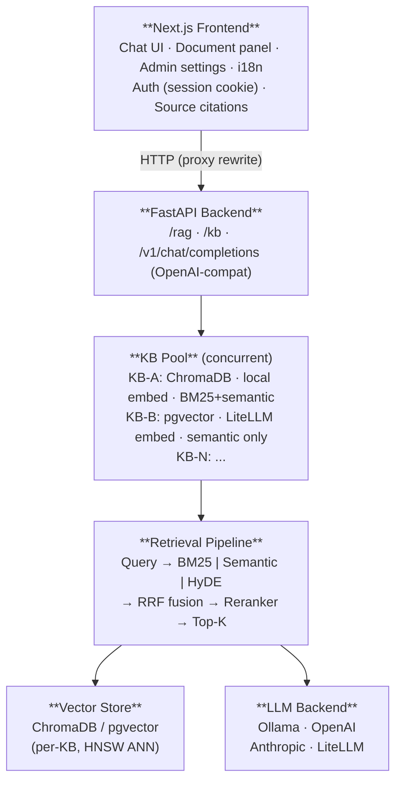

# Lancy — Architecture Reference

---

## Overview



Lancy is a full-stack RAG system structured in three layers:

```
Frontend (Next.js)
  ↕ HTTP (same-origin proxy rewrite — no CORS issues)
Backend (FastAPI + asyncio)
  ↕ per-KB config
Vector Store(s) · Embedding Backend(s) · LLM Backend(s)
```

Everything is **async** — the FastAPI backend uses `asyncio` throughout with
`loop.run_in_executor` for CPU-bound operations (embedding inference, BM25 indexing).
This prevents the SSE/streaming endpoint from blocking under concurrent load.

---

## Backend

### Entry Point

`backend/src/lancy/main.py`

FastAPI application with three routers:

| Router | Prefix | Purpose |
|--------|--------|---------|
| `rag_router` | `/rag` | Query endpoint, streaming responses |
| `kb_router` | `/kb` | KB management: list, create, switch, index, cancel |
| `piles_router` | `/piles` | Per-session document piles: upload, process, delete |
| `openai_compat_router` | `/v1` | OpenAI-compatible chat completions |

The conversational toolkit (`conversational-toolkit/`) is a separate installable package
providing the core primitives: agents, embeddings, LLMs, vector stores, chunkers, retriever.

### KB Pool

`backend/src/lancy/kb_pool.py` · `backend/src/lancy/kb_router.py`

```
knowledge_bases.json              persisted registry (kb_router.py)
  └── KB definitions: id, name, data_dirs, embedding_backend, embedding_model, ...

KBPool                            in-memory pool (kb_pool.py)
  ├── _pool: dict[kb_id, LoadedKB]   ← all currently loaded KBs
  ├── _emb: shared embedding model   ← one instance, shared across KBs
  ├── _emb_key: (backend, model)     ← pool is locked to this embedding config
  └── _active_id: str                ← the "current" KB for new conversations

LoadedKB
  ├── kb: KBInfo       ← config snapshot
  ├── vs: VectorStore  ← per-KB vector store
  ├── agent: CustomRAG ← per-KB RAG agent
  └── probe_bm25: BM25Retriever | None  ← lazy BM25 cache for Retrieval Probe

DispatchingAgent
  └── answer_stream(query) → resolves KB from conversation.kb_id → delegates to entry.agent
```

**Concurrent activation:** `POST /kb/{id}/activate` **adds** the KB to the pool — the
previous KB stays loaded and available for in-flight conversations. The pool's `active_id`
is updated so new conversations default to the activated KB.

**Embedding compatibility:** All KBs in the pool must share the same `(embedding_backend,
embedding_model)` pair, because the embedding model is instantiated once and shared. Adding
a KB with a different embedding config raises `EmbeddingConflict` (HTTP 409). Pass
`?reset=true` to clear the pool first and reload with the new config.

**Per-conversation routing:** `DispatchingAgent` reads `conversation.kb_id` from the DB
on each query and dispatches to the matching pool entry. Falls back to the active KB when
no match is found (e.g. conversation predates multi-KB support).

**Unloading:** `POST /kb/{id}/deactivate` removes a KB from the pool. In-flight streams
hold a local reference to the `LoadedKB` and complete safely — Python's reference counting
prevents premature GC.

**Indexing:** `POST /kb/{id}/reindex` runs in a background thread via `run_in_executor`.
A `_cancel_requested` global flag enables mid-indexing cancellation. The endpoint returns
a 409 if indexing is already running.

**Document Upload:** `POST /kb/{id}/documents` accepts a multipart file + JSON metadata,
saves it to a temp path, and triggers the same ingestion pipeline via `BackgroundTasks`.
The temp file is always deleted after ingestion. Requires a stable `document_id` in metadata;
re-uploading the same `document_id` replaces the existing chunks (delete-then-insert).

### Piles

`backend/src/lancy/piles_router.py`

A **pile** is a set of documents a user uploads for their own use, kept out of the
curated corpus. Structurally a pile is what a KB already is — a directory of files
plus a vector store — so processing one hands a synthetic `KBInfo` to `run_ingestion`
and inherits hash deduplication, OCR, chunking and image handling unchanged.

```
user-piles/<pile_id>/            raw uploads (gitignored)
db/vs_pile_<pile_id>             the pile's own vector store (ChromaDB)
rag_pile_<pile_id>               …or its own table (pgvector)
db/user_config.db
  ├── piles                      id, owner_id, name, status, embedding_key, vs_type, counts
  └── pile_files                 pile_id, filename (on disk), source_file (as uploaded)
```

Piles are deliberately **not** in `knowledge_bases.json`: that registry belongs to
the admin and is rewritten wholesale, while piles are created and discarded per user.

**Isolation is physical, not filtered.** Each pile has its own store, so no query
needs an owner filter to stay inside one user's documents, and no filter bug can
cross that boundary. It also keeps each pile's BM25 corpus to its own documents
rather than putting every user's text in one in-memory index.

**Ownership is the lookup.** Every read is keyed on `(pile_id, owner_id)`; there is
no function that resolves a pile without its owner, so a guessed id from another
session is indistinguishable from one that does not exist (404, never 403). The owner
is the `x-session-id` header the Next.js middleware injects, falling back to `admin`
exactly as `SessionCookieProvider` does — the same identity conversation history is
already scoped by.

**Lifecycle:**

```
draft       created, files uploaded, never processed
processing  run_ingestion in flight (vs_type is stamped BEFORE the run, so a
            crashed run still leaves the store backend known and droppable)
ready       store matches the pile's current file set
stale       files added or removed since the last run — reprocess to include them
failed      last run raised; the exception CLASS is recorded, never its message,
            which can carry a connection string or a local path
```

**Inherited configuration.** Embedding backend and model, store backend and
connection string, chunk parameters and OCR settings are copied from the active KB at
process time, so a pile always matches the one embedding model the pool is running.
The `(backend, model)` pair is recorded as `embedding_key` on the pile row. Two
separate questions follow from it, because the answers differ by consumer:

| Flag | Meaning | Who needs it |
|------|---------|--------------|
| `has_store` | processed at least once — chunks exist | Batch analysis |
| `embedding_current` | those vectors match the active embedding config | Retrieval |

Batch analysis reads chunk text by metadata and never embeds, so a pile built with a
since-replaced embedding model remains analyzable. Retrieval compares vectors and
does not.

**Serialisation.** Processing a pile uses the same embedding model and chunking
process pool as an admin reindex, so the two must not overlap: `POST
/piles/{id}/process` returns 409 while `_index_status["indexing"]` is set. Pile runs
pass `db_engine=None`, keeping user filenames out of the admin's `ingest_events`
provenance log, and report a neutral `kb_name` so the shared index-status badge does
not publish one user's pile names to everyone. That same neutral name is how
`GET /piles` recognises the shared index status as a pile run: while a pile is
`processing` its `progress` carries the status fields (phase, file n of m, embedding
batches) plus the run's start time, and stays at `preparing` while the status belongs
to anything else, such as the upload worker. Processing runs inside the backend
process, so a restart ends it unrecorded; the startup hook in `main.py` marks piles
still `processing` as `failed` (`Interrupted`), which unlocks them for a new run.

**Consumption.** `POST /rag/document-stats` and `POST /rag/analyze-document` accept a
`pile_id` and resolve it through `open_pile_store`, which opens the store directly —
piles are never pool residents, since this path needs no retrievers, no BM25 index and
no embedding model. The store is closed before the LLM call, so a pgvector pile does
not hold a connection pool open across a generation. The factory is injected into
`create_rag_router` rather than imported, because `lancy.ingestion` imports
`rag_router` and the reverse edge would cycle.

### Batch Analysis Jobs

A batch run is a server-side job (`batch_router.py`), so it does not depend on the
browser that started it. `POST /batch/job` records the job in `user_config.db` and
starts a background task that analyzes the documents one after another, writing each
result as it finishes; the Batch Analysis tab polls `GET /batch/job` while the job runs.
Each document goes through the same function as `POST /rag/analyze-document`, which
`create_rag_router` exposes as `router.analyze_one` for `main.py` to inject. The job
passes the caller's session id and role explicitly, because the request has returned
by the time the task runs.

**One job per session, keyed by definition.** A job's definition is its source
(`kb_id` or `pile_id`), `id_field`, prompt and schema. Rerunning the same definition
extends the job and analyzes only documents without a result, including failed ones.
A different definition would leave the stored results answering other questions, so
it replaces the job, and only after the caller confirms (`replace: true`).

**Restarts.** The task lives in the backend process, so a restart ends it without a
chance to record that. The startup hook in `main.py` marks jobs still `running` as
`interrupted`; the finished results stay, and rerunning the definition continues
with the missing documents. Both resets run in the lifespan rather than in router
construction: the chunking pool spawns worker processes, which re-import `lancy.main`
and rebuild every router while the server is running.

Question sets are stored per session in the same database (`batch_question_sets`).

### Ingestion Pipeline

Ingestion converts documents on disk into embedded chunks stored in the vector store.
It is triggered by `POST /api/v1/rag/reindex` or automatically on startup when the
store is empty.

#### Flow

```
POST /reindex (reset: bool)
  │
  ├── run_ingestion(kb, reset, db_dir)         ingestion.py
  │     │
  │     ├── make_vector_store(...)             create VS instance in async context
  │     │     (ChromaDB: reused below;
  │     │      PGVector: new instance per thread — AsyncEngine is loop-bound)
  │     │
  │     ├── [if not reset] vs.get_file_hashes()
  │     │     returns set[SHA-256] already in the store
  │     │     warns if store is non-empty but has no hashes (pre-dedup KB)
  │     │
  │     ├── executor: _prepass()               blocking I/O — thread pool
  │     │     ├── _collect_candidate_files()   extension + size + EVALUATION filter
  │     │     ├── file_hash(path) × N          SHA-256 of raw bytes, one per file
  │     │     ├── cross-run dedup              skip if hash in existing_hashes
  │     │     └── within-batch dedup           skip if hash already seen this run
  │     │                                      (add to seen_hashes only on success)
  │     │
  │     ├── executor: load_chunks(             blocking I/O + CPU — thread pool
  │     │     include_files=filtered,
  │     │     file_hashes=hash_map)
  │     │     └── per file: parse → chunk → stamp chunk.metadata["file_hash"]
  │     │
  │     └── executor/new-loop: build_vector_store(   CPU-bound — separate thread
  │           chunks, embedding_model,
  │           existing_hashes=existing_hashes)
  │           ├── [if reset] clear collection
  │           ├── group chunks by file_hash
  │           ├── skip groups already in store  (belt-and-suspenders)
  │           └── embed + insert remaining chunks in batches
  │
  └── returns ReindexResult(chunks_indexed, files_processed, files_skipped, reset)
```

#### Deduplication: Two Layers

| Layer | Where | What it skips |
|-------|-------|---------------|
| Cross-run | Pre-pass | Files whose hash is already in the vector store — no parsing, no embedding |
| Within-batch | Pre-pass | Files with identical content to another file in the same run — only the first occurrence is processed |

Both layers operate before `load_chunks`, so expensive PDF parsing is never wasted on
a file that would ultimately be discarded.

`reset=True` bypasses cross-run dedup (store is cleared). Within-batch dedup still
applies — two identical files in one run always produce one set of chunks.

#### Key Functions

| Function | File | Role |
|----------|------|------|
| `file_hash(path)` | `feature0_baseline_rag.py` | SHA-256 of raw file bytes |
| `EmailChunker` | `chunking/email_chunker.py` | `.eml` → message chunk + one group per attachment |
| `_collect_candidate_files(dirs, ...)` | `feature0_baseline_rag.py` | Extension + size + EVALUATION filter, shared by pre-pass and `load_chunks` |
| `load_chunks(..., include_files, file_hashes)` | `feature0_baseline_rag.py` | Parse files, stamp `chunk.metadata["file_hash"]` |
| `build_vector_store(..., existing_hashes)` | `feature0_baseline_rag.py` | Embed and persist; skips chunks already in store |
| `VectorStore.get_file_hashes()` | `vectorstores/base.py` | Abstract: return set of hashes in the store |
| `run_ingestion(kb, reset, db_dir)` | `ingestion.py` | Orchestrates all steps above; returns `(chunks, files, skipped)` |

#### Email (.eml)

`conversational-toolkit/src/conversational_toolkit/chunking/email_chunker.py`

An email is both a message and a carrier for documents, so `EmailChunker` emits
both: one chunk for the message (headers rendered as searchable text, body
converted from HTML when there is no plain part) plus one group per attachment,
each handed to the chunker registered for that attachment's own extension. An
attached PDF therefore goes through the full PDF pipeline, OCR included, on the
same settings as one sitting in a data directory.

Every chunk an email produces carries its headers in metadata
(`email_from`, `email_subject`, `email_date`, `email_message_id`, and
`email_attachment` on attachment chunks), so a hit deep inside an attachment can
still name the message it arrived on.

`.eml` is registered in `_CHUNKERS` *after* the table is built, because the chunker
needs the finished table to dispatch attachments. It receives a copy with `.eml`
removed, so an email attached to an email is listed by name and skipped rather than
recursed into. An attachment whose own chunker raises costs only that attachment;
one with no registered chunker is still named in the message chunk's attachment list.

#### Threading Model

The ingestion pipeline has three distinct blocking phases, each isolated to avoid
blocking the FastAPI event loop:

```
async context (run_ingestion)
  │
  ├── await vs.get_file_hashes()      [async — ChromaDB uses run_in_executor internally]
  │
  ├── await run_in_executor(_prepass) [blocking I/O: file discovery + SHA-256 hashing]
  │
  ├── await run_in_executor(load_chunks) [blocking I/O + CPU: PDF parsing, chunking]
  │
  └── await run_in_executor(_sync_build_vs)
        └── new_loop.run_until_complete(build_vector_store(...))
              [CPU-bound: SentenceTransformer.encode() — needs its own event loop]
```

`_sync_build_vs` creates a fresh event loop because `SentenceTransformer.encode()`
and the subsequent `insert_chunks` calls must complete synchronously from the thread's
perspective. For PGVector, a new `AsyncEngine` is created inside this thread (engine
is bound to the loop that created it and cannot be shared across loops).

---

### Retrieval Pipeline

`conversational-toolkit/src/conversational_toolkit/retriever/`

```
Query
  ↓
[Optional] Keyword Extraction
  → LLM lists the question's key terms, synonyms, inflections and translations
    into the corpus languages
  → the question becomes a KeywordQuery carrying them; BM25 scores them at half
    weight, other retrievers see the plain question
  → expanded queries (below) then go to semantic search only

[Optional] Query Expansion
  → LLM generates N rephrased variants, in a corpus language
  → each variant retrieves independently

[Optional] HyDE
  → LLM generates a hypothetical answer document, in a corpus language
  → used for semantic search only (a SemanticOnlyQuery); BM25 skips it

[Parallel, per variant]
  → BM25 retrieval — stop words dropped, words stemmed (text_analysis.py)
  → Semantic retrieval (ANN on the variant's embedding)

[RRF Fusion]
  → Reciprocal Rank Fusion merges ranked lists
  → Score: Σ 1 / (k + rank_i)   (k=60 default)

[Optional] LLM Reranking
  → the fused pool (candidate pool size) is ranked in one LLM call against the user's question
  → each candidate is sent whole, table padding compacted, within a budget of half num_ctx
  → over budget, each is cut to the same share: the window holding the most query terms
  → top-K kept; the rest returned as discarded

→ Top-K chunks passed to generator, table padding compacted
```

**Keyword analysis.** `retriever/text_analysis.py` handles German, English, French and Italian. A chunk is stemmed in its own language, detected from the stop words it contains. A query word is expanded to its stem in every supported language plus the word itself, so an English term still matches inside a German chunk; stop words are dropped in the query's language only. That alone misses an inflected English term inside other-language text — the German stemmer leaves "keys" as `keys`, while "key" stems to `key` everywhere — so a chunk that is not English also indexes each word's English stem. The extra stems are not counted in the chunk length BM25 normalises by, and a query word scores once, by its best-matching form, so they never count a word twice. Length normalisation `b` is a setting (`bm25_b`, default 0.6 rather than the usual 0.75): chunks range from a slide's few lines to 8,000 characters, and one mention in a long chunk still answers the question. The analysed terms are logged per query (`BM25 terms for …`). The BM25 index is built in memory when a KB loads, so analysis changes need no reindex.

**Keyword extraction.** Keyword search matches the question's own words, so it misses a document that uses a synonym or another language ("surrogate key" vs. "Ersatzschlüssel"). With `keyword_extraction` on, one utility-LLM call (`utils/retriever.py: keyword_extraction`) turns the question into search terms: its key terms and the same meaning in other words or languages, but not the question's field or neighbouring concepts, because every extra term lifts the chunks containing it. They feed keyword search only — semantic search already works across languages — and score at `EXPANSION_WEIGHT` (0.5) on top of the question's own terms, so a synonym does not outrank the word the user typed. Expanded queries would add their words at full weight, so with extraction on they become `SemanticOnlyQuery`s. Translations go into the corpus languages other than the question's own, detected from its stop words; a model asked to translate into the language it is reading picks languages of its own.

**Corpus languages.** HyDE, query expansion and keyword extraction generate text that is matched against the corpus, so they write in its languages. `lancy/language.py` detects each document's language at ingestion with `py3langid` (bundled model, no download), stores it on the document's chunks as metadata `language` and per document in `kb_stats_<kb>.json`; `KBInfo.language_counts` holds documents per language. A language counts once it holds 10 % of the documents, main language first; an admin-set `KBInfo.corpus_languages` replaces the detected list. The agent reads the list per question, so a KB edit applies without a rebuild. Generated text is written in the question's language when the corpus has it, otherwise in the main corpus language; with no languages known, in the question's language. Documents indexed before detection existed get their language from their stored chunks on the next incremental reindex (`kb_stats.backfill_languages`), without re-chunking.

**Debugging keyword search.** The Retrieval Probe returns the query's analysed terms and, per chunk, the content words that matched them, highlighted in the UI. `BM25Retriever.search_listener` reports every search — query, terms, extra terms, detected language, every hit it returns with score and matched terms — to `lancy/bm25_debug.py`, which keeps the last 50 questions in memory for **Admin → BM25 Debug** while recording is on. Recording is off by default and on restart, and never written to disk: entries hold users' questions.

**Provenance.** Every chunk records how it was found in `ChunkMatch.ranks`: its best rank in semantic and keyword search, and its position before reranking (`pre_rerank`). Fusion keeps the best rank per method. The answer carries every chunk sent to the LLM (`AgentAnswer.retrieved`) and the reranker's discards (`AgentAnswer.discarded`). The controller saves each of them once as a source of the message, with the record under `metadata._retrieval`: chunk id, title, position, `sent`, `cited`, ranks. The API's `sources` stays the cited chunks only; `retrieved` lists all of them, sent first in context order, then the discards. The first streamed chunk of an answer already carries `retrieved`, uncited, so the client can show the documents while the answer is written.

**Table compaction.** `utils/text.py: compact_markdown_tables` strips the alignment padding docling writes into markdown table rows. It applies wherever a model reads chunk text — reranker, answer context, batch analysis — and to the character counts behind the context budgets. Stored chunks and embeddings keep the padding.

### Vector Stores

| Backend | Class | When to use |
|---------|-------|-------------|
| `chromadb` | `ChromaDBVectorStore` | Default, local, no dependencies |
| `pgvector` | `PgVectorVectorStore` | PostgreSQL available, larger scale, SQL filtering |

Both backends:
- Use HNSW index for ANN search
- Support metadata filtering (source file, page number)
- Store chunk text + embedding + metadata per document

### Embedding Backends

| Backend | Class | Notes |
|---------|-------|-------|
| `local` | `SentenceTransformerEmbeddings` | Fully offline, CPU/GPU, default |
| `ollama` | `OllamaEmbeddings` | Local Ollama server |
| `litellm` | `LiteLLMEmbeddings` | Any OpenAI-compatible embed endpoint |
| `custom` | `CustomEmbeddings` | Custom base URL + model |

**Dimension lock:** A ChromaDB collection is created with the dimension of the first
embedding. Changing embedding model after indexing requires a full re-index with `reset=True`.

### LLM Backends

| Backend | Class | Notes |
|---------|-------|-------|
| `ollama` | `OllamaLLM` | Local inference, privacy-preserving |
| `openai` | `OpenAILLM` | OpenAI API |
| `anthropic` | `AnthropicLLM` | Anthropic API |
| `litellm` | `LiteLLMLLM` | LiteLLM proxy — routes to any provider |

All LLM backends implement the same interface (`BaseLLM.stream()`), so the retrieval
pipeline and agent are backend-agnostic.

### OpenAI-Compatible Endpoint

`backend/src/lancy/openai_compat_router.py`

```
POST /v1/chat/completions
  → routed by DispatchingAgent (resolves KB from conversation_id, falls back to active KB)
  → returns OpenAI-format response (streaming supported)

GET /v1/models
  → returns available KBs as model list
```

Any OpenAI-compatible client (Open WebUI, curl, n8n, Cursor) can point to this endpoint
with `base_url=http://localhost:8080/v1` and `api_key=<anything>`.

### Async Architecture

Critical for production: all blocking operations use `run_in_executor`:

```python
# Embedding inference (CPU-bound)
loop = asyncio.get_event_loop()
embeddings = await loop.run_in_executor(None, model.encode, texts)

# ChromaDB operations (I/O + Python GIL)
results = await loop.run_in_executor(None, collection.query, ...)
```

Without this, the SSE streaming endpoint blocks under load — the frontend shows a frozen
response until the full generation completes.

---

## Frontend

### Tech Stack

- Next.js 15 (Pages Router)
- TypeScript
- Tailwind CSS
- shadcn/ui components

### API Routing

The frontend uses Next.js **API route rewrites** to proxy backend calls:

```
Browser → GET /api/rag/query
  → Next.js API route
  → fetches http://BACKEND_URL/rag/query (server-side)
  → streams response back to browser
```

Set `BACKEND_URL` in `frontend/.env` to point at the backend host when running on separate machines.

### Chat Page

`frontend/src/pages/index.tsx` → `frontend/src/components/next/`

The chat at `/` and `/c/{id}`:
- **Sidebar** (`chat-sidebar.tsx`) — new chat, search, conversations grouped by period with knowledge base and date; the user menu holds Settings, Reference, Advanced Features, Admin, the classic view, and version and uptime.
- **Thread and composer** (`chat-message.tsx`, `composer.tsx`) — answers with citations that open their document in the panel; the composer has the knowledge base picker (`kb-picker.tsx`) and a `+` menu for the metadata filter and chat-only.
- **Document panel** (`document-panel.tsx`) — per answer, every retrieved document grouped from the message's `retrieved` list (`lib/retrieved.ts`): cited and sent passages, the search method that found them, reranker discards. Arrows in its header step through the answers that used documents; the chat scrolls to the answer stepped to and tints it briefly. Ticking documents arms expand-context for the next question, with a token budget check (`use-context-budget.ts`).

The KB picker only selects a knowledge base for the session; it never writes settings.

The classic chat stays at `/legacy` and `/legacy/c/{id}` (`components/template/home.tsx`) until it is removed. Session labels — grouping conversations for A/B evaluation runs — and the sidebar's per-conversation config badges exist only there.

### RAG Settings

`frontend/src/components/sections/rag-config-panel.tsx`

The settings panel, shown full width as **Admin → Knowledge & RAG** (`layout="page"`) and as a sidebar in the classic chat. The Advanced Features page has no settings panel: its tabs share one knowledge base selector (`explorer-kb-select.tsx`), which selects a KB the way the chat's KB picker does — session storage plus the `lancy-kb-changed` event — so the probe, chunk browser, analytics and batch analysis follow it. The settings panel holds:
- Knowledge base selector and management — compatible KBs selectable normally; incompatible KBs greyed out (user) or red+⚠ (admin, triggers pool reset); controls lock with a spinner while a KB is loading
- LLM model and temperature
- Embedding backend and model
- Retrieval: k, BM25 on/off, HyDE on/off, Query Expansion on/off, Keyword Extraction on/off, Reranking on/off, corpus languages of the KB
- Presets
- Re-index / cancel indexing controls with live progress

Settings are the admin's: they are saved to `rag_config.json` and the system prompt file, and every user's questions run with them. Users see the panel read-only; `POST /api/v1/rag/config` is admin-only, because a save rebuilds the agents of every loaded KB. Each conversation snapshots the settings at creation (`rag_config_snapshot`).

### Auth

Auth lives entirely in the **Next.js layer** — the FastAPI backend is unprotected at the network level and relies on the frontend proxy as its sole entry point in a normal deployment.

**Key files:**

| File | Role |
|------|------|
| `frontend/src/middleware.ts` | Guards every route; verifies the session cookie on each request |
| `frontend/src/pages/api/auth/login.ts` | Accepts password, determines role, issues signed cookie |
| `frontend/src/pages/api/auth/me.ts` | Returns `{ role }` for the current session |
| `frontend/src/pages/api/auth/admin-config.ts` | GET: returns active mode. POST: sets/clears admin password |
| `frontend/src/lib/auth.ts` | `signToken()` / `verifyToken()` — HMAC-SHA256, works in Edge + Node |
| `frontend/src/lib/auth-config.ts` | Reads/writes `auth_config.json` (gitignored, Node.js only) |
| `frontend/src/hooks/useRole.ts` | React hook — calls `/api/auth/me`, returns current role |

**Session cookie:** `rag_auth` holds an HMAC-SHA256 signed token in the format `role.expiry_unix.hex_sig`. The role (`admin` or `user`) is embedded in the token and verified by the middleware using `APP_PASSWORD` as the signing key. No role string is stored in an unsigned cookie.

#### Access modes

Three modes are planned, with increasing complexity:

**Mode 1 — single password (default)**
All users who log in share one password (`APP_PASSWORD`). Every session is treated as admin. No `auth_config.json` present.

**Mode 2 — role separation (two passwords)**
Activated by setting an admin password via Settings → Role Separation. The admin password is stored in `frontend/auth_config.json` (gitignored) or the `ADMIN_PASSWORD` env var (for scripted deployments).

- `APP_PASSWORD` → user role: read-only view of RAG config, session retrieval settings only
- `ADMIN_PASSWORD` → admin role: full config access, reindexing, preset management, system prompt

The active mode is determined at login time. `middleware.ts` only needs `APP_PASSWORD` (to verify the signed token); it does not need to know `ADMIN_PASSWORD`.

**Mode 3 — external directory / SSO (planned)**
AD/LDAP bind or OAuth/OIDC. Group membership maps to roles. The `getRole()` function in `middleware.ts` is the seam — replacing its implementation is sufficient to add an external provider. The two-password model remains as a fallback admin credential that works without the directory.

#### Two-cookie coexistence

Two cookies exist simultaneously in a logged-in browser session:

| Cookie | Set by | Purpose |
|--------|--------|---------|
| `rag_auth` | Next.js login endpoint | Auth gate + role — verified by middleware on every request |
| `access_token` | Backend `SessionCookieProvider` | Per-browser identity for conversation history scoping |

`access_token` currently resolves every browser to the hardcoded identity `"admin"`. The original code generated a unique per-browser UUID here; a comment marks the spot for re-enabling it when per-user session isolation is introduced in Mode 3.

---

## Sequence Diagram — Query Flow

```
User            Frontend        Backend         VectorStore     LLM
 │                │               │                 │             │
 │──── query ────►│               │                 │             │
 │                │──── POST ────►│                 │             │
 │                │         [Query Expansion?]       │             │
 │                │               │──── embed ─────►│             │
 │                │               │◄─── vectors ────│             │
 │                │               │                 │             │
 │                │         [HyDE?] generate hypothetical          │
 │                │               │────────────────────────────►  │
 │                │               │◄─── hypothetical doc ──────── │
 │                │               │──── embed hypo ─►│            │
 │                │               │                  │            │
 │                │         [BM25 + Semantic parallel]│            │
 │                │               │──── ANN query ──►│            │
 │                │               │◄─── top-K chunks─│            │
 │                │               │                  │            │
 │                │         [RRF fusion → Rerank?]    │            │
 │                │               │                  │            │
 │                │         Build prompt (system + chunks + query) │
 │                │               │────────────────────────────►  │
 │                │         stream tokens                          │
 │                │◄── SSE ───────│◄─── token ──────────────────  │
 │◄─ token ───────│               │                 │             │
```
